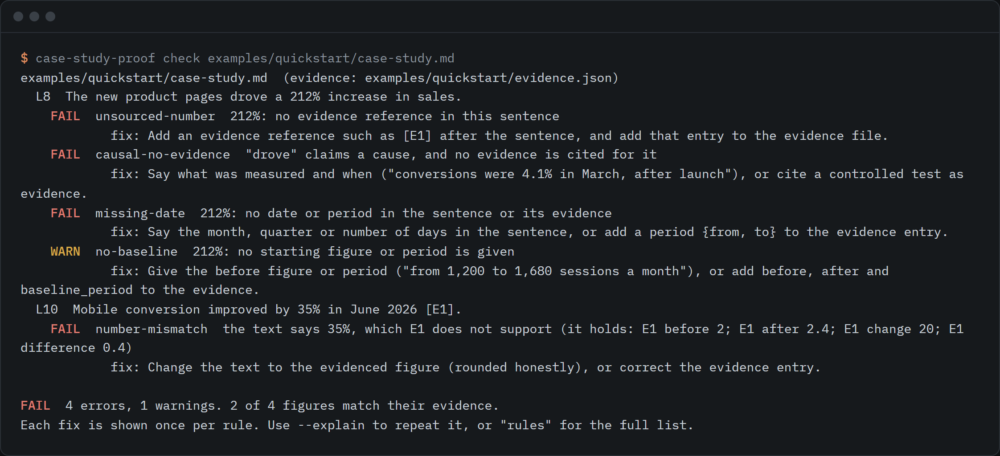
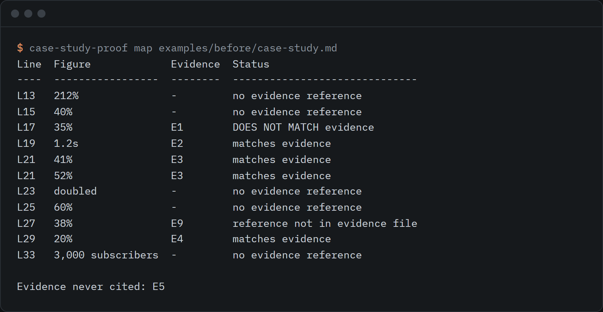

# case-study-proof

Lints case studies for unsourced numbers, causal wording without evidence and missing dates, with a claims-to-evidence template.



```sh
npx github:reidifydesign/case-study-proof check case-study.md
```

Needs Node 18 or later. No dependencies. Nothing leaves your machine.

## Why this exists

Reidify writes case studies under one rule: only measured figures, each with a date, and no claim that our work caused a result. On 2026-09-30 we looked for a tool that checks that rule on a case study and did not find one. The nearest are [marketing-machine](https://github.com/cagatayuncu/marketing-machine) (20 stars, last push 2026-08-11), which checks product marketing copy against a codebase, and general claim-checking agent skills. [portfolio-case-study-generator](https://github.com/SonwaneyY/portfolio-case-study-generator) (21 stars, read 2026-09-30) writes case studies, which is a different job.

This tool does the narrow thing. You write the case study in Markdown, keep the figures in an evidence file, and it tells you which sentences make a claim the evidence does not back.

## How it works

1. Every figure in the text ends with a reference such as `[E1]`.
2. Each reference has an entry in `evidence.json`: the metric, the value (or before and after), the source, the period it covers and the day you read it.
3. `check` reads both, finds every figure, and reports what is wrong and how to fix it.

Start from the skeleton:

```sh
npx github:reidifydesign/case-study-proof init my-case-study
```

That writes `case-study.md` and `evidence.json` with `[[CONFIRM: ...]]` slots. The checker fails until every slot is filled, so a half-finished draft cannot pass.

## Use it

```sh
case-study-proof check case-study.md            # lint one or more files
case-study-proof check a.md b.md --strict       # warnings fail too
case-study-proof check case-study.md --json     # for scripts and CI
case-study-proof check draft.md --sentences-only  # sentences only: no document-level warnings
case-study-proof map case-study.md              # every figure and its evidence
case-study-proof map case-study.md --markdown   # the same, as a table to paste
case-study-proof init [dir]                     # write the skeleton
case-study-proof rules                          # every rule, why, and the fix
```

The evidence file is found from `evidence:` in the front matter, then `<name>.evidence.json`, then `evidence.json` beside the case study. Or pass `--evidence file.json`.

`--sentences-only` drops the two document-level warnings (`undated-document` and `no-evidence-file`), so a pasted paragraph or a draft with no front matter and no evidence file yet shows only what its sentences claim.

Exit codes: 0 clean, 1 findings at error level (or warnings with `--strict`), 2 usage error. A note (`info` level) never changes the exit code.



### What it checks

| Rule | Level | Catches |
| --- | --- | --- |
| `unsourced-number` | error | A figure with no `[E#]` reference or link |
| `number-mismatch` | error | A figure the cited evidence does not support, including wrong percentages worked out from before and after |
| `dangling-ref` | error | A reference to an id the evidence file does not have |
| `causal-no-evidence` | error | "Led to", "drove", "thanks to" and similar, about an outcome, with nothing cited. Verbs such as "generated" or "delivered" need a subject and an outcome noun, so "AI-generated photography" is not a cause |
| `causal-weak-evidence` | warn | Causal wording backed only by observational evidence |
| `missing-date` | error | A figure with no month, quarter or period, in the sentence or its evidence |
| `unnamed-metric` | error | "Up 60%" with no word saying what went up |
| `no-baseline` | warn | "Doubled" or "up 40%" with no starting figure or period |
| `direction-mismatch` | warn | The text says down, the before and after say up |
| `vague-claim` | warn | "Significant", "massive" and similar, with no figure. Negated uses ("no guaranteed results") are left alone |
| `outcome-claim-no-measure` | warn | A promised outcome with no figure or evidence: "turns interest into enquiries", "built to convert", "makes booking effortless", "builds authority" |
| `verification-no-method` | warn | "Verified clean", "zero offenses", "passed all checks" or "fully tested" with no named tool or check and no date in the sentence or the ones next to it |
| `attribution-wording` | info | "Played a part in", "one of several factors", "rather than anything the rebuild did". A note to check that the evidence says the same, never an error |
| `placeholder-left` | error | `[[CONFIRM: ...]]`, `TODO`, `TBD` |
| `evidence-incomplete`, `vague-source`, `future-date`, `unused-evidence` | mixed | Problems in the evidence file itself |
| `undated-document`, `ignore-without-reason` | mixed | Missing front matter date, silent suppressions |

Each finding says what it saw, why it matters and what to change. Run `case-study-proof rules` for the full text.

The checker reads these figure forms: percentages, multipliers (`3x`), currency (`$40k`, `Rs 5 lakh`), counts of outcome nouns (`38 enquiries`), counts with a plus (`128+ students`), before and after pairs (`from 17 to 41`, `from 18 the week before to 187`), times and sizes (`1.2s`), scores (`98/100`, `105/105`, `48/50`), ranks (`top 3`), and words such as "doubled" and "in half".

What it leaves alone on purpose:

- Years (1900 to 2099) are never figures. A real count in that range needs a thousands separator (`2,026 orders`) to be read.
- A number directly after a Capitalised word that is not a common quantifier, such as `Studio 54` or `Route 66`, is read as part of a name. "March 12" is read as a date.
- Format and spec durations: "up to 30 seconds each", "at most 15 seconds", "9:16 vertical at 1080x1920". A sentence about speed or saving ("load in at most 2 seconds", "saves 30 seconds per order") is still a measurement.
- Durations such as "6 weeks" or "5+ years", version numbers and step numbers.
- `100% owned by the client` and similar yes-or-no status wording.
- Dates (`12/09/2026`), fractions (`1/2`), hours (`24/7`) and fiscal years (`2025/26`) are not scores.
- A pair such as "open from 9 to 5", "ranging from 3 to 5", or one followed by a unit or month ("from 3 to 5 weeks").

How the newer forms are checked against the evidence:

- A pair must match the evidence `before` and `after`, in that order. "From 41 to 17" against before 17 and after 41 is a mismatch. Several pairs in one sentence are split at ", <noun phrase> from" so each is read on its own.
- `N+` is accepted when the evidence holds at least N and under twice N, so `100+` does not stand for 900.
- A percentage that follows figures in the sentence or two before it, in the same paragraph or after a sourced sentence, is marked `derived` (and listed so in `map`) when the arithmetic from those figures matches it to the rounding shown. "Clicks fell from 845 to 351 in June 2026 [E1]. That is a fall of 58%." passes. A percentage with its own reference is still checked against that reference.

### The evidence file

```json
{
  "evidence": [
    {
      "id": "E2",
      "metric": "organic sessions",
      "kind": "analytics-export",
      "source": "exports/sessions-2026-03-06.csv",
      "observed_on": "2026-07-02",
      "period": { "from": "2026-06-01", "to": "2026-06-30" },
      "baseline_period": { "from": "2026-03-01", "to": "2026-03-31" },
      "before": 1200,
      "after": 1680,
      "design": "observational"
    }
  ]
}
```

- Give `before` and `after` and the checker works out the change, so "up 40%" is checked, not trusted.
- `value` covers a single figure. `unit` can be `ms` or `s` and the checker converts between them.
- `design` defaults to observational. Set it to `ab-test`, `holdout`, `randomised` or `controlled-experiment` only if that test was really run. Only then does the checker accept causal wording.
- `observed_on` is the day you read the figure, `period` is the dates it covers.

### Suppressing a finding

```md
<!-- proof-ignore: unsourced-number, missing-date -- owner's quote, signed email on file -->
The owner told us orders were up 50%.
```

A reason after `--` is required. Without one, the suppression is itself an error.

A comment on its own line covers the whole paragraph, list item or table row below it, every sentence in it, so one comment can cover a quoted passage. A comment at the end of a line covers the sentence on that line.

```md
<!-- proof-ignore: unsourced-number, missing-date, unnamed-metric -- quoted from the client's email, kept in the project folder -->
They told us orders rose 50%. They also said enquiries rose 30%.
```

### Config

An optional `case-study-proof.config.json` beside the case study, or in the working directory:

```json
{
  "metrics": ["gallery saves", "brief submissions"],
  "causalDesigns": ["geo-holdout"],
  "ignoreRules": ["vague-claim"]
}
```

### In CI

```yaml
- run: npx github:reidifydesign/case-study-proof check content/case-studies/*.md --strict
```

## Examples

`examples/` holds one fictional shop, Fernbank Pottery. It is not a real client, and every figure is invented.

- `examples/quickstart/` is the three-sentence draft in the image above.
- `examples/before/` is a draft that breaks most rules.
- `examples/after/` is the same case study rewritten. It passes with no findings.

## What it does not do

- It does not check that a source is true. It checks that the text, the evidence entry and the dates agree. A made-up evidence entry passes.
- It cannot open the export or URL an entry points to. Keep the file in the repo, or link a page you can re-open.
- It is rule-based and reads one sentence at a time. It will miss claims worded in ways it does not know, and it will sometimes flag a sentence that is fine. Use `proof-ignore` with a reason for those, and open an issue with the sentence.
- Causal detection looks for common phrasing in sentences about an outcome. "Because" in a design rationale is left alone. Passive or very indirect wording can slip through.
- Figures written as words ("nine out of ten") are not read, apart from percentages and a few words such as "doubled".
- The name, spec and status rules are guesses from nearby words. A real figure written like a name ("Route 66 orders" meaning sixty-six orders) will be skipped, and a limit worded unusually will still be read as a measurement. Use `proof-ignore` with a reason.
- Outcome, attribution and verification rules look for a short list of phrasings. They are conservative on purpose: "built to last" and "turn the page into a PDF" are left alone, and so are many real promises worded differently.
- `verification-no-method` accepts any named tool or check in the sentence or the ones beside it. It cannot tell whether the tool really ran or was the right one.
- A derived percentage is checked only against figures in the sentences just before it. It does not look anywhere else in the document.
- Units are compared loosely. It converts seconds and milliseconds, and does not convert currencies or bytes.
- English only. Markdown only.

## Development

```sh
npm test
```

Tests use `node:test` and cover the parser, the figure detectors, every rule, and the command line. The sentences in the tests are invented.

## Licence

MIT. Built by [@rishsadh](https://github.com/rishsadh) at [Reidify](https://reidify.design).
